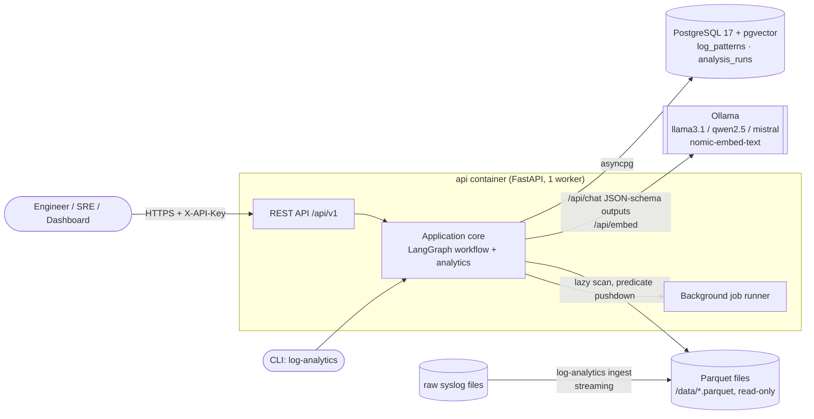
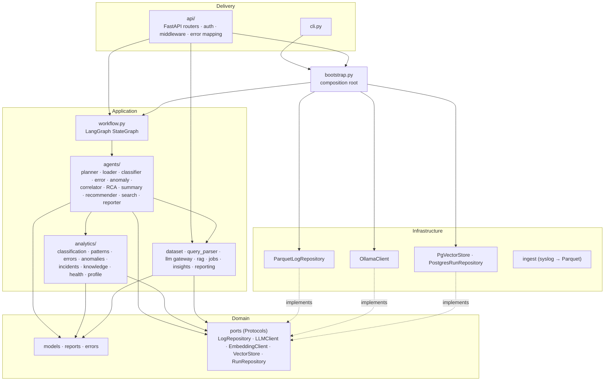
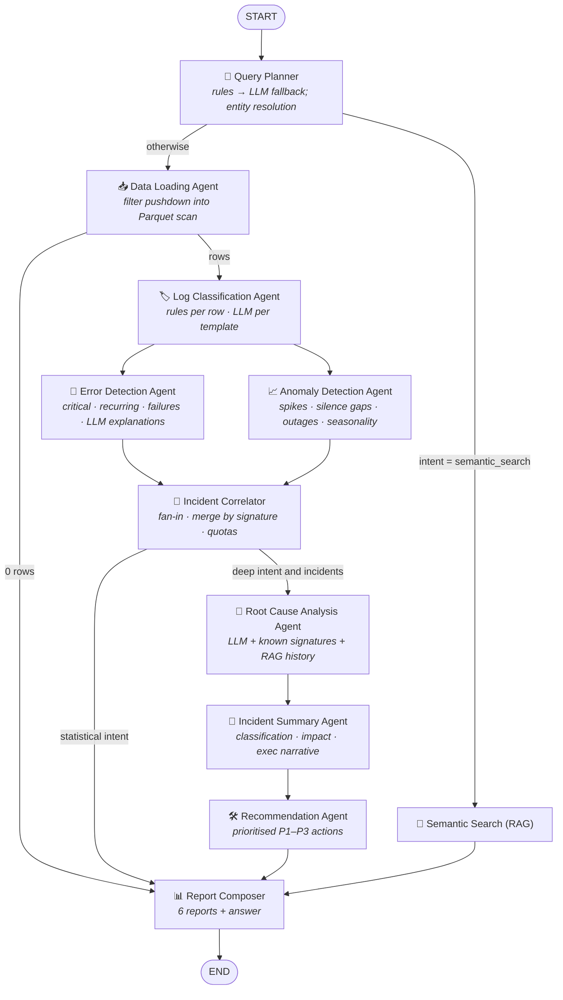
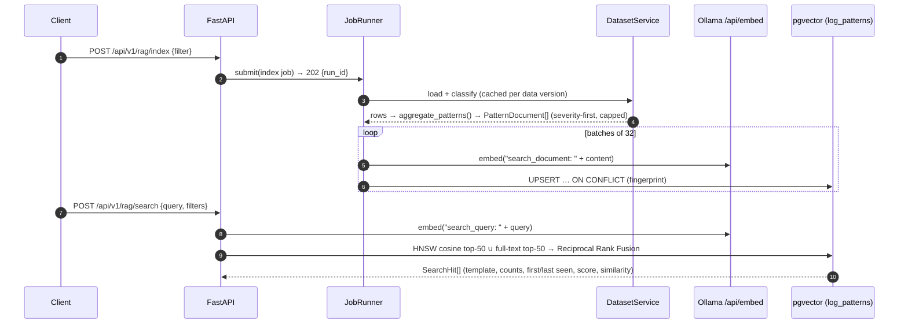
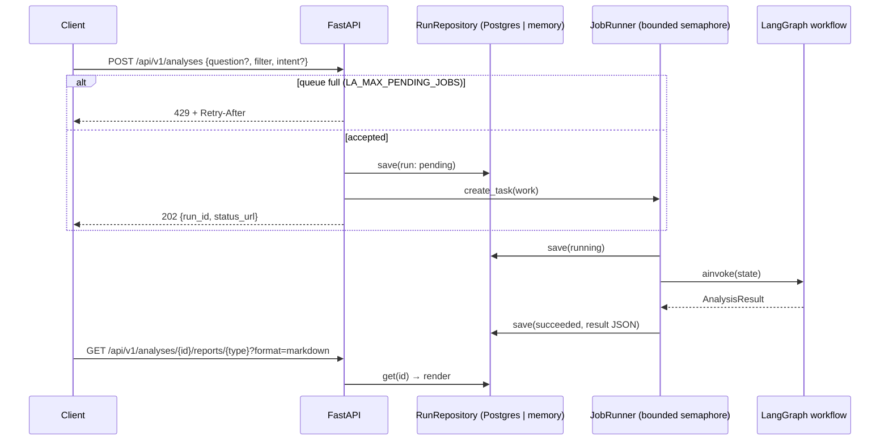
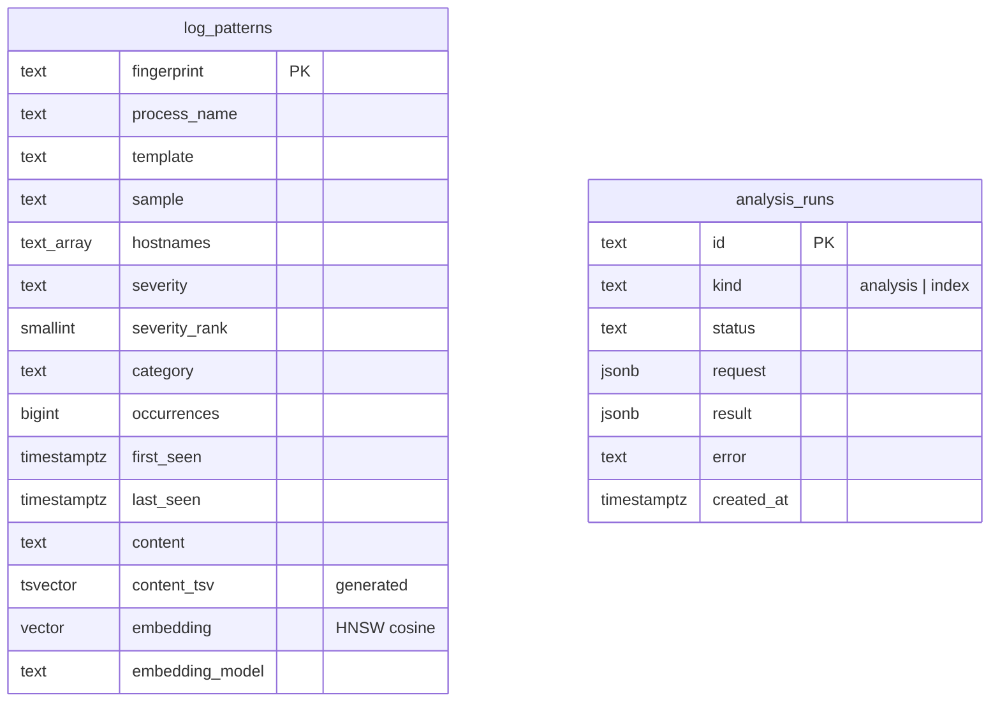

# Architecture

## Design principles

1. **Deterministic facts first, LLM interpretation second.** Counting, grouping, spike detection and
   correlation over millions of rows run in vectorised Polars. The LLM never sees raw volumes. It gets
   compact, redacted evidence (top templates, windows, counts) and explains, classifies and recommends.
   Every LLM-produced section has a deterministic fallback, so the system still works with no model.
2. **Clean Architecture.** `domain` (entities + ports) ← `application` (use cases, analytics, agents)
   ← `infrastructure` (Parquet, Ollama, pgvector) / `api` (FastAPI). Only `bootstrap.py` (the
   composition root) knows concrete classes; everything else gets its collaborators through constructor
   injection.
3. **Patterns, not lines.** Log lines collapse into *templates* (variable tokens masked). Templates are the
   unit of classification by the LLM, explanation, incident building and semantic indexing. 1.46M lines
   become a few thousand templates.
4. **Safe by default.** Secrets (JWTs, bearer tokens, passwords, API keys, AWS keys) and e-mail addresses
   are redacted before anything is classified, returned, embedded or sent to a model. Log text is wrapped
   as untrusted `<evidence>` in prompts, and every id an LLM returns is checked against known ids.

## System context and deployment

## Layers and dependencies

## LangGraph workflow

`GET /api/v1/workflow/diagram` returns this graph as generated live from the compiled `StateGraph`.
The annotated version:

| Node | Responsibility | LLM use (all optional) |
|---|---|---|
| `planner` | NL question → intent + validated `LogFilter`. Rules handle common phrasings. Relative time resolves against the dataset end (or now). Hosts and processes are matched against the data. | Only when no rule matches (`PlannedQuery`). The LLM's entities are re-validated and times re-resolved deterministically. |
| `data_loader` | Loads the working set once and stages it in the `FrameStore` (DataFrames stay outside graph state). With the cache on, that is one filter over the classified frame; otherwise time/host/process filters are pushed into the Parquet scan and the classifier enriches the rows. | – |
| `classifier` | Severity, category and template for every row; secret redaction; keyword and severity filters. | Classifies the top templates (`TemplateLabels`). Categories are applied to all matching rows with one join. |
| `error_detector` | Critical errors, frequent/recurring patterns, per-host/process stats, explicit failures (OOM, crash, unit failures, abnormal exits), restarts (PID replacement + whether errors preceded it). | Explains the top patterns (`PatternExplanations`). |
| `anomaly_detector` | Robust z-score against a trailing rolling median (MAD scale, Poisson floor) for volume and error spikes; daily-seasonality labelling; host silence; heartbeat gaps for regular processes; outage bursts. | – |
| `correlator` | Turns findings into ranked incidents: merges windows/patterns that share a known signature, enforces per-kind quotas, attaches time-correlated signals and knowledge-base hints. | – |
| `root_cause_analyst` | RCA for every incident. RAG retrieval of similar historical patterns. Falls back to curated signatures. | `RootCauseBatch` for the top N incidents. |
| `incident_summarizer` | Incident classification, impact and summary; executive narrative. | `IncidentSummaryBatch`. |
| `recommender` | Prioritised remediation. Curated actions fill in for incidents the LLM did not cover. | `ActionPlan`. |
| `semantic_search` | Hybrid retrieval over indexed patterns. | – |
| `reporter` | Builds the six reports; answers the question with intent-specific context. | Free-text answer, with a deterministic Markdown fallback. |

Routing keeps cost proportional to the question. *"Summarize errors by host"* uses at most 3 LLM calls
(classification, explanations, answer). A full analysis uses 6. When the model is down, a circuit
breaker in `LLMGateway` stops paying a timeout per agent.

State (`application/state.py`) is a small typed dict of domain objects. Parallel branches merge through
reducers (`warnings` concatenates, `timings_ms` merges), which is also what lets error and anomaly
detection run concurrently.

## RAG pipeline

* **Indexing unit:** a pattern document (template + example + process, hosts, severity, category,
  occurrences, time span), keyed by a stable SHA-1 fingerprint, so re-indexing is idempotent.
* **Hybrid retrieval:** `embedding <=> query` (HNSW, cosine) fused with `ts_rank_cd` over a generated
  `tsvector` column. Exact tokens such as error codes and unit names match even when embeddings miss them.
* **In the workflow:** the RCA agent retrieves similar historical patterns per incident and passes
  them to the model as `similar_historical_patterns`.

## Analysis job lifecycle

* **Capacity:** background jobs and request-scoped heavy work (`/query`, `/insights/*`, `/logs/stats`) share the
  same `LA_MAX_CONCURRENT_JOBS` slots. A request that cannot get a slot within `LA_CAPACITY_WAIT_S` gets `429`,
  so memory stays bounded by the number of slots, not by the number of clients.
* **Restarts:** at startup, runs still `pending`/`running` belong to a process that no longer exists (crash, OOM
  kill) and are marked failed. That is only safe with one replica per database; several replicas need run
  ownership (heartbeats) first.
* **Retention:** runs older than `LA_RUN_RETENTION_DAYS` are deleted at startup and every 6 hours.

## Data model (PostgreSQL)

The schema is created idempotently at startup (`infrastructure/postgres.py`). If an existing table's
vector dimension doesn't match `LA_EMBEDDING_DIM`, startup fails with a clear error.

## Performance (measured on the bundled 1.46M-row file, 12-core laptop)

| Step | Time |
|---|---|
| `ingest` 269 MB raw syslog → Parquet (streaming) | 2.2 s |
| Load + normalise Parquet into cache | 0.2–0.3 s |
| Rule classification of all rows (once per data version, at warm-up) | ~4.4 s |
| Deterministic analysis of all rows (load → reports), warm | ~0.7 s |
| LLM prompts per agent | ≤ ~2.5k tokens (fits `num_ctx` 8192) |

With `LA_CACHE_DATASET=false`, every query streams from Parquet and classifies only the rows it selects.
Use that for datasets larger than memory.

## Extension points

* **New failure signature:** add a `KnowledgeRule` in `application/analytics/knowledge.py`. It improves
  RCA, recommendations and incident merging, with or without an LLM.
* **New log source:** implement `LogRepository` (e.g. S3 Parquet, ClickHouse) and wire it in `bootstrap.py`.
* **Different LLM provider:** implement `LLMClient` / `EmbeddingClient`. Agents depend only on the ports.
* **Horizontal scale:** replace `JobRunner` with a queue (Arq/Celery/SQS) behind the same `submit`
  contract; run state already lives in PostgreSQL.
